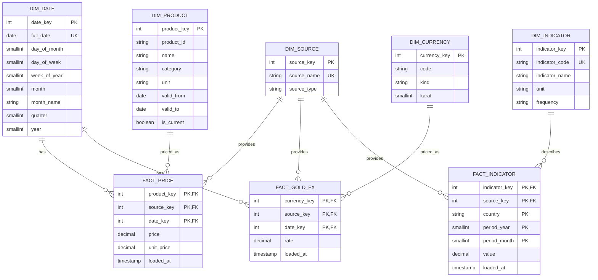

# Warehouse ERD (schema `dwh`)

Star schema of the Egypt Economic Intelligence Platform. Dimensions are loaded first, then facts.
`dim_product` is SCD Type 2: every change of name/category/unit creates a new row (`product_key`) while `product_id` stays the same, and only one row per product has `is_current = true`.
Names follow the DDL in `sql/40_dwh.sql` exactly.

## Notes

- `dim_date.date_key` is `YYYYMMDD` and is pre-filled for 2020-2035.
- `fact_indicator.period_month = 0` means annual data; `value` can be NULL (World Bank has gaps).
- `dim_currency` is unique on `(code, kind, COALESCE(karat, 0))`.
- `dim_product` has a unique partial index on `product_id WHERE is_current`.